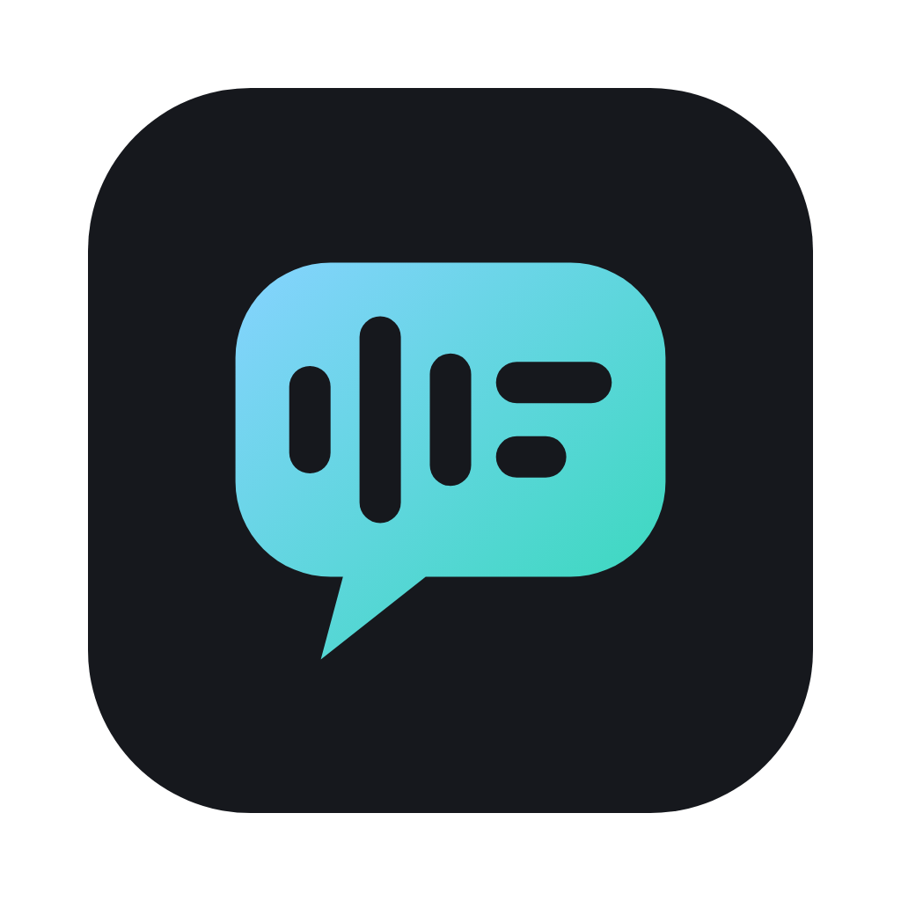
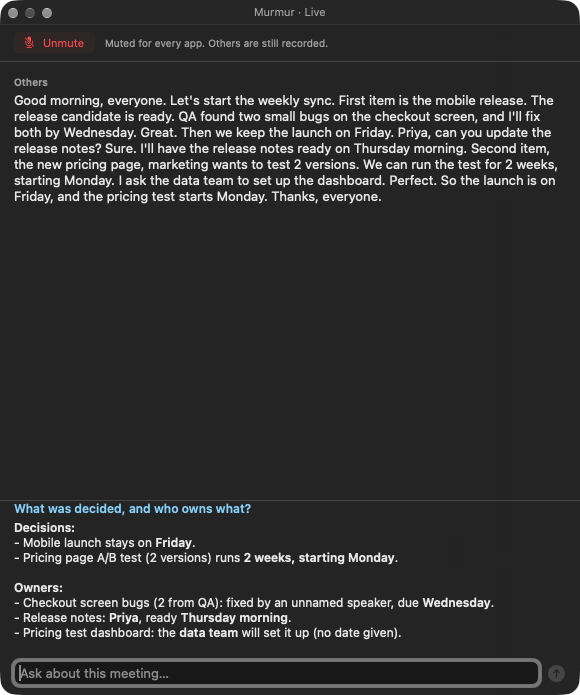
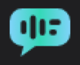

<p align="center"></p>

<h1 align="center">Murmur</h1>

<p align="center">
  Local meeting notes for the macOS menu bar.<br>
  Press a shortcut, have your meeting, press it again. Get a summary, decisions, action items and the full transcript.
</p>

<p align="center"></p>

Murmur records the meeting from any app (Zoom, Meet, Teams, a browser tab), shows a live transcript
while people talk, lets you ask questions about what was said, and writes a Markdown note when you stop.

- **Works with any meeting app.** It records what the Mac plays plus your microphone. No bots join the call.
- **Transcribed on your Mac** by Apple's on-device speech recognition. Audio never leaves the computer.
- **Summarized by Claude Code or Codex**, through the login you already have. No API keys, no accounts.
- **You vs Others.** Your microphone is labeled **You**, everyone else **Others**, with echo removal when you're on speakers.
- **Ask about the meeting while it happens**, from the live window.
- **Mute for real.** One shortcut mutes your mic for every app and stops Murmur from recording you.
- **Plain files.** One `.md` note and one `.m4a` per meeting in `~/MeetingNotes`. No database, no telemetry.

## Contents

- [What you get](#what-you-get)
- [Requirements](#requirements)
- [Install](#install)
- [Using Murmur](#using-murmur)
- [Settings](#settings)
- [Privacy](#privacy)
- [Troubleshooting](#troubleshooting)
- [Contributing](#contributing)

## What you get

A few seconds after you stop recording, `~/MeetingNotes/2026-10-22-1432.md` appears next to
`2026-10-22-1432.m4a`. Here is a real note from a two-minute test meeting:

```markdown
# Weekly Sync: Mobile Release and Pricing Test

*Thursday, 22 October 2026 at 14:32 · 2 min · [audio](2026-10-22-1432.m4a) · transcribed with Apple on-device speech · summarized with Claude Code*

## Summary
- The mobile release candidate is ready, but QA found 2 small bugs on the checkout screen.
- One team member committed to fixing both checkout bugs by Wednesday so the release stays on track.
- Priya will prepare the release notes by Thursday morning ahead of the Friday launch.
- Marketing wants to test 2 versions of the new pricing page in a 2-week test starting Monday.
- A team member will ask the data team to set up a dashboard for the pricing test.

## Decisions
- The mobile launch stays on Friday.
- The pricing page test of 2 versions will run for 2 weeks, starting Monday.

## Action items
- [ ] **Unassigned**: Fix the 2 checkout screen bugs found by QA (due Wednesday)
- [ ] **Priya**: Update the release notes (due Thursday morning)
- [ ] **Unassigned**: Ask the data team to set up the dashboard for the pricing test

---

## Transcript

**[00:14] Others:** Good morning, everyone. Let's start the weekly sync. First item is the mobile release. …
```

Notes are plain Markdown, so they work in Obsidian, VS Code, iA Writer or any text editor.

## Requirements

| What | Why |
|---|---|
| **macOS 26 or later, Apple Silicon** | Apple's `SpeechAnalyzer` on-device transcription |
| **Xcode Command Line Tools** (`xcode-select --install`) | To build the app. Full Xcode is not needed |
| **Homebrew** | To install `ffmpeg`, which mixes the two audio tracks |
| **[Claude Code](https://docs.anthropic.com/en/docs/claude-code) or [Codex](https://github.com/openai/codex)**, installed and logged in | Summaries and the live chat. Each uses your existing plan |

Murmur is built from source; there is no prebuilt download.

## Install

```bash
git clone https://github.com/martinsbicudo/murmur.git
cd murmur
make deps      # brew install ffmpeg, create ~/.config/murmur/.env
make cert      # once: create a local code-signing identity (see below)
make install   # build, sign, copy to /Applications/Murmur.app and launch it
```

The speech-bubble icon appears in the menu bar. Murmur has no Dock icon. Choose **Launch at Login** in its
menu to keep it running.

> If you use a menu bar manager (Ice, Bartender) or have a MacBook with a notch, the icon may be hidden
> behind the overflow. Drag it to the visible area so you can see when you're recording.

### Permissions

macOS asks for these the first time you start a recording:

| Permission | Why |
|---|---|
| **Microphone** | Your side of the conversation |
| **Screen & System Audio Recording** | The other participants' audio. ScreenCaptureKit is the standard way to capture system audio; Murmur records no video |
| **Speech Recognition** (if asked) | On-device transcription |
| **Notifications** (optional) | The "notes ready" banner. Click it to open the note |

After allowing Screen & System Audio Recording, **quit and reopen Murmur**: macOS only applies it on launch.
The purple recording indicator in the menu bar while Murmur records is expected.

The first time a language is used, macOS downloads its speech model (a few hundred MB, once).

### Why `make cert`

macOS ties privacy permissions to the app's code signature. An ad-hoc signed build gets a new signature
every time, so macOS would forget the permissions after each update. `make cert` creates a self-signed
"Murmur Local Signing" certificate in its own keychain (`~/Library/Keychains/murmur-signing.keychain-db`).
Every build is signed with it, so permissions survive updates. It never leaves your Mac and isn't trusted
for anything else.

### Updating and uninstalling

```bash
make install      # after pulling changes: rebuilds and replaces the app, keeps notes, settings and permissions
make uninstall    # removes the app; notes (~/MeetingNotes) and settings (~/.config/murmur) stay
```

## Using Murmur

### Record

| Shortcut | Does |
|---|---|
| **⌃⌥⌘R** (Control-Option-Command-R) | Start or stop recording, from any app |
| **⌃⌥⌘M** (Control-Option-Command-M) | Mute or unmute your microphone while recording |

Hold Control, Option and Command (the three keys in the bottom-left corner), then press the letter.
You can also use the menu bar icon: **Start Recording** / **Stop Recording**.



A short "tink" plays on start and a "pop" on stop. While recording, a light-blue-to-green gradient flows
through the menu bar icon, with the elapsed time next to it.

What gets recorded: **your microphone** plus **everything the Mac plays**. That's the other people in the
meeting, but also music, videos and notification sounds.

### The live window

The **Murmur · Live** window opens when recording starts and updates as people talk. Text still being
recognized appears in grey and settles when the sentence ends. It floats above other apps without taking
focus from your meeting, follows you across Spaces and remembers where you put it. Close it any time and
reopen it from the menu (**Show Live Transcript**).

Labels come from the audio source, not from voice recognition: whatever your microphone hears is **You**,
whatever the Mac plays is **Others**. Everyone on the call is **Others**; Murmur doesn't guess names.
On speakers, your microphone also hears the other people. Murmur hides those echoes, but headphones give
the cleanest result.

### Ask about the meeting

Type a question at the bottom of the live window ("what did they decide about the launch?", "what did
Sean ask me?") and press Return. Claude Code or Codex answers in about five seconds, using only what was
transcribed since this recording started: nothing from older meetings, nothing said while you were muted.
Follow-up questions remember the earlier ones. A new recording starts a clean chat.

### Mute

**⌃⌥⌘M**, the **Mute** button at the top of the live window, or menu › **Mute Microphone**:

- mutes your microphone **for every app**, so the meeting can't hear you either;
- stops Murmur from recording or transcribing you. The other people keep being recorded;
- shows a crossed-out mic next to the timer in the menu bar.

Press it again to unmute. Stopping the recording or quitting Murmur also puts your mic back exactly as it
was, and if Murmur ever crashes while muted, it restores the mic on the next launch. Your meeting app's own
mute button doesn't change; it just receives silence.

### Process an existing recording

Menu › **Process Audio File…** (or `make process FILE=path`) transcribes and summarizes any audio file.
It also accepts the hidden `~/MeetingNotes/.recording-*` folders left behind if Murmur quit mid-recording,
with You/Others labels. A plain audio file has one mixed track, so its transcript has no labels.

## Settings

Everything lives in `~/.config/murmur/.env` (menu › **Settings (.env)…**). It's re-read at every
recording, so most changes need no restart. The template with every option is [`.env.example`](.env.example).

```bash
SUMMARY_ENGINE=claude-code     # or codex; the other one is the fallback
LANGUAGE=pt-BR                 # or en-US, es-ES…; auto follows the system language
HOTKEY=ctrl+option+cmd+r       # start/stop shortcut, or off (restart Murmur after changing)
MUTE_HOTKEY=ctrl+option+cmd+m  # mute shortcut, or off (restart Murmur after changing)
LIVE_TRANSCRIPT=on             # off: don't open the live window automatically
CLAUDE_CODE_MODEL=sonnet       # summary model (default: your Claude Code default)
CLAUDE_CODE_CHAT_MODEL=haiku   # live chat model (default: sonnet)
CODEX_MODEL=gpt-5.5            # summary model for Codex
NOTES_DIR=~/Documents/Notes    # default: ~/MeetingNotes
```

Apple's recognizer handles one language per meeting, so set `LANGUAGE` to what people speak. The summary
is written in the meeting's language, and chat answers in the language of your question. Every setting is
described in [docs/configuration.md](docs/configuration.md).

## Privacy

- Audio, transcripts and notes stay in `~/MeetingNotes`; settings in `~/.config/murmur`.
- Transcription runs on the Mac. The only outbound traffic is transcript text: sent to Anthropic
  (Claude Code) or OpenAI (Codex) for the summary, and when you ask a question in the live window.
- Claude Code runs with no tools, no MCP servers, no hooks and no saved session; Codex runs read-only and
  ephemeral. Details in [docs/summaries.md](docs/summaries.md).
- No analytics, crash reporting or update checks.
- Recording people may require their consent where you live. Tell them.

## Troubleshooting

| Problem | Fix |
|---|---|
| "Murmur couldn't start recording" | Allow Screen & System Audio Recording, then quit and reopen Murmur |
| Note says "No speech detected" | The meeting audio has to play through the Mac (headphones are fine). A USB speakerphone that plays audio by itself isn't captured |
| Garbled text, or "doesn't support …" | Set `LANGUAGE` to the meeting's language, such as `pt-BR` or `en-US` |
| "Live transcript unavailable" | The speech model is still downloading. Recording continues and the final note is still transcribed |
| "Summary failed: … Not logged in" | Run `claude` (or `codex`) in a terminal once and log in, then **Process Audio File…** on the saved audio |
| Permissions reset after every update | You built without `make cert`. Run it, `make install`, and allow the permissions one last time |
| Can't see the menu bar icon | It's hidden by a menu bar manager or the notch; drag it out |

Logs: menu › **Show Log** (`~/Library/Logs/Murmur.log`). More in [docs/troubleshooting.md](docs/troubleshooting.md).

## Contributing

Contributions are welcome. Murmur is a small native Swift app (no Xcode project, no dependencies beyond
Apple frameworks and `ffmpeg`), so it's quick to get running.

### Development setup

```bash
xcode-select --install   # if you don't have the Command Line Tools
make deps && make cert   # once
make test                # unit tests (Swift Testing)
make install             # build and run your change
```

The change loop is: edit `Sources/Murmur/…`, `make test`, `make install`. Logs go to
`~/Library/Logs/Murmur.log`. With only the Command Line Tools, `swift test` sometimes fails with
"plugin for module 'TestingMacros' not found" after adding a file; run it again, or `swift package clean`
first. SwiftUI's `@State` macro isn't available with the Command Line Tools either, so view state lives in
`@Observable` models.

### How it fits together

```
⌃⌥⌘R ─► AudioRecorder (ScreenCaptureKit) ─┬─► mic.caf (You) + system.caf (Others)
                                          └─► LiveTranscriber ─► live window ─► chat (AgentCLI)
stop ─► ffmpeg mix ─► .m4a
     ─► SpeechEngine per track ─► TranscriptMerger (labels, echo removal)
     ─► Summarizer (AgentCLI: claude -p / codex exec) ─► Note .md
```

| Area | Where |
|---|---|
| Menu, state machine, shortcuts | `AppDelegate.swift`, `HotKey.swift` |
| Recording and track alignment | `AudioRecorder.swift`, `TrackWriter.swift` |
| Live transcript and chat | `LiveSession.swift`, `LiveTranscriber.swift`, `LiveTranscriptModel.swift`, `LiveTranscriptWindow.swift`, `LiveChatModel.swift`, `LiveChatView.swift`, `MeetingChat.swift` |
| Final transcription and echo removal | `SpeechEngine.swift`, `Transcript.swift` |
| Claude Code / Codex calls | `AgentCLI.swift`, `Summarizer.swift` |
| Microphone mute | `MicrophoneMuter.swift`, `CoreAudioMicrophone.swift` |
| Note layout and pipeline | `Note.swift`, `NotePipeline.swift` |
| Icon and colours | `brand/generate.py`, `RecordingIcon.swift`, `Brand.swift` ([brand/BRAND.md](brand/BRAND.md)) |

The technical docs in [`docs/`](docs/README.md) explain each part in depth: architecture, recording,
live transcript, transcription, summaries, notes, configuration, development and troubleshooting.

### Product decisions

These are deliberate. Please open an issue to discuss before changing them:

- Summaries and chat only through **Claude Code or Codex** CLIs. No API-key providers, no local LLMs.
- Transcription only through **Apple's on-device recognizer**.
- Speaker labels are **You vs Others**, from the audio source. No voice diarization, no guessed names.
- **Everything stays local** except transcript text sent to the summary engine.

### Guidelines

- Every change to logic comes with unit tests in `Tests/MurmurTests/`, named after the behavior they protect.
  Tests never touch real hardware or call Claude/Codex (see `MicrophoneMuterTests` and `LiveChatModelTests` for fakes).
- Keep files small and single-purpose, and match the existing style: descriptive names, no comments except a
  short *why* that the code can't express.
- When behavior or settings change, update the matching page in `docs/` and, if it's user-facing, this README.
- `make icons` regenerates the brand assets from `brand/generate.py`. It needs the `render_png.py` script
  from the logo-design skill (set `RENDER_PNG=/path/to/render_png.py`); the generated files are committed,
  so you only need it when changing the icon.
