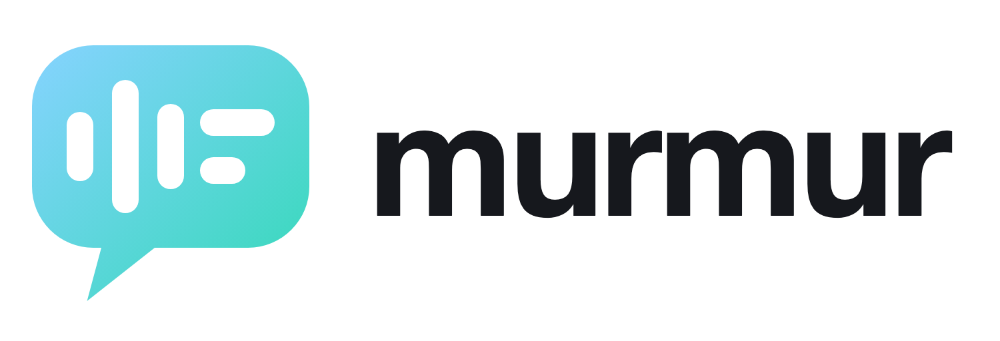

# Murmur brand kit

**The mark:** a speech bubble whose voice waveform settles into lines of text. It shows
in one picture what the app does: a conversation becomes notes.

Everything here is generated from [`generate.py`](generate.py). To change the mark or the
colours, edit that file and run `make icons`. That rebuilds the SVGs, `Resources/AppIcon.icns`
and the menu bar icons. Then run `make install`.

## Colours

| Role | Name | HEX | RGB | Use |
|---|---|---|---|---|
| Primary dark | Graphite | `#16181D` | 22 24 29 | App icon tile, text, mark on light backgrounds |
| Accent (gradient start) | Sky | `#86D3FF` | 134 211 255 | Top-left of the accent gradient |
| Accent (gradient end) | Pool | `#34D9B8` | 52 217 184 | Bottom-right of the accent gradient |
| Light | Paper | `#F4EFE6` | 244 239 230 | Backgrounds, text on graphite |
| Support | Slate | `#5B6170` | 91 97 112 | Secondary text, captions |

The accent is a diagonal linear gradient, Sky → Pool, top-left to bottom-right (`url(#murmur-gradient)`
in the SVGs). It's the mark on dark backgrounds, the recording state and the You label in the live window.

Contrast: sky on graphite 10.8:1, pool on graphite 9.9:1, paper on graphite 15.5:1, slate on paper 5.4:1.
Never set the gradient on paper (1.4–1.6:1). On light backgrounds, use the graphite mark.

Why sky → pool: a light, calm blue-green that reads as "on" without the alarm of red, and stays
legible on the graphite tile and in the menu bar.

## Files

| File | Use |
|---|---|
| `svg/murmur-symbol.svg` | Graphite mark, for light backgrounds |
| `svg/murmur-symbol-gradient.svg` | Gradient mark, for dark backgrounds |
| `svg/murmur-symbol-two-tone.svg` | Gradient bubble with graphite inner marks |
| `svg/murmur-symbol-black.svg` / `-white.svg` | One-colour versions |
| `svg/murmur-app-icon.svg` | macOS app icon master (1024 grid) |
| `svg/murmur-app-icon-small.svg` | Larger mark for 16 and 32 px icon slots |
| `svg/menubar-idle.svg` | Menu bar template (black; macOS tints it) |
| `svg/menubar-recording.svg` | Menu bar while recording (static gradient; the app animates it in code, see `RecordingIcon.swift`) |
| `svg/murmur-lockup*.svg` | Symbol + wordmark |
| `png/` | Rendered app icon and lockups for READMEs and slides |
| `concepts.png` | The concepts that were explored |

## Construction

- 256-unit grid. The bubble is 208 × 152 with 46-unit corners. The tail is a 15° wedge.
- The inner marks are 20-unit pills: three waveform bars (52, 100, 64 high), then two text lines.
- The inner marks are cut out of the bubble (even-odd fill), so the mark works in any single colour.
- App icon: graphite rounded square (824 on a 1024 canvas, 185 corner radius) with the gradient mark.
- Menu bar: drawn separately on a 22 × 18 grid with thicker gaps, so it stays legible at real size.

## Usage

- **Clear space:** keep empty space at least as tall as the tail (40 units on the 256 grid) around the mark.
- **Minimum size:** symbol 16 px; lockup 96 px wide.
- **Wordmark:** "murmur", lowercase, in Inter or SF Pro Display Semibold, tracking −2.5%. The lockup
  SVGs use live text. Outline it in a vector editor before sending it to print.
- **Don't** rotate the mark, recolour the inner marks separately on the single-colour versions, add
  other gradients or shadows, or place the gradient mark on paper.
